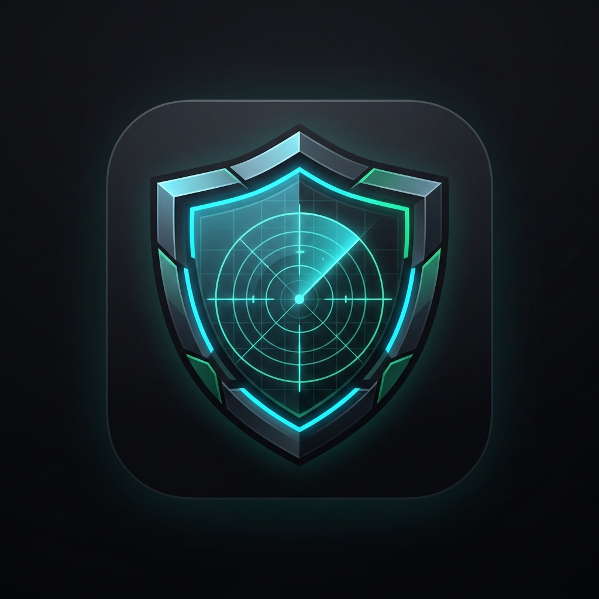

<div align="center">
  
  <h1>AntiTelguard</h1>
  <p><b>Privacy-First Telegram Threat Intelligence & Anti-Malware Appliance with Web Dashboard</b></p>
</div>

AntiTelguard is a self-hostable Telegram guard bot that protects Telegram groups and private chats by inspecting incoming **files** and **URLs** against threat intelligence providers (such as VirusTotal).

Designed specifically with **zero-disk data privacy**: files sent in Telegram are hashed **strictly in volatile RAM in 64KB stream chunks** and immediately discarded. No file is ever written to disk, and no files are uploaded to third-party databases.

---

## ✨ Features

* 🚀 **Web Admin Dashboard (`http://localhost:8080`)**: Zero-code setup. Easily enter and test your Telegram Bot Token and VirusTotal API key via an intuitive web interface.
* 🛡️ **Zero-Disk Streaming**: Files sent to groups are streamed through `hashlib.sha256()` directly in memory. **0 bytes are saved to disk.**
* ⚡ **Live Hot-Reload**: Update thresholds, actions, or API keys in the web UI, and the bot restarts dynamically without stopping the container.
* 🔍 **Real-Time Group Threat Inspection**:
  * Scans both **documents / media files** and **URLs / hyperlinks**.
  * Reacts to clean files with custom emojis (e.g. 👍).
  * Automatically reacts, replies with threat warning cards, or removes malicious messages based on your rules.
* 📊 **Audit Logs & Metrics**: Persistent SQLite event database tracking scanned targets, vendor detection counts, and actions taken.
* 💾 **Smart TTL Caching**: Built-in 24h caching avoids burning free VirusTotal API rate limits (4 req/min).

---

## 🚀 Quick Start (Docker Compose)

The primary and recommended way to deploy AntiTelguard is via **Docker Compose**:

### 1. Clone & Launch
```bash
git clone https://github.com/your-username/antitelguard.git
cd antitelguard

# Start container in detached mode
docker compose up -d
```

### 2. Configure via Web Console
1. Open your browser and navigate to:
   ```
   http://localhost:8080
   ```
2. Enter your **Telegram Bot Token** (from `@BotFather`) and your **VirusTotal API Key**.
3. Click **"Save & Hot-Reload Bot"**. AntiTelguard will automatically connect and start inspecting group messages!

---

### 📋 Useful Docker Operations

| Task | Command |
| :--- | :--- |
| **View Live Logs** | `docker compose logs -f` |
| **Restart Bot & Web Server** | `docker compose restart` |
| **Rebuild After Code Updates** | `docker compose up -d --build` |
| **Stop Container** | `docker compose down` |

---

## ⚙️ Telegram Bot Setup Checklist

Before adding your bot to groups, ensure privacy mode is configured in Telegram:

1. Open Telegram and message [`@BotFather`](https://t.me/BotFather).
2. Create your bot with `/newbot`.
3. **Disable Group Privacy Mode (Crucial):**
   * Send `/setprivacy` to `@BotFather`.
   * Select your newly created bot.
   * Choose **Disable**.
   * *(Note: If Group Privacy Mode remains enabled, Telegram prevents bots from seeing regular messages and files in groups unless mentioned or made an admin).*
4. Add the bot to your target group.
5. *(Optional)* If you choose the **"Delete Malicious Message & Post Warning"** policy in the dashboard, grant your bot the **Delete Messages** permission in the group.

---

## 🔒 Privacy & Threat Intel Architecture

```
[ Telegram Group ]
       │
       ├── File Sent ──► HTTP Chunk Stream ──► Memory SHA-256 Buffer (Zero-Disk)
       │                                               │
       └── URL Sent  ──► Base64 URL Identifier         │
                                                       ▼
                                            Query VT API v3 Hash
                                                       │
                                   ┌───────────────────┴───────────────────┐
                                   ▼                                       ▼
                             [ Clean Item ]                        [ Threat Detected ]
                              React (👍)                     • React (👎)
                                                             • Post Security Warning Card
                                                             • (Optional) Auto-Delete Message
```

* **No File Storage:** Chunks are discarded by Python's garbage collector immediately after feeding the SHA-256 digest.
* **No File Uploads:** Only the 64-character hash is queried against VirusTotal's `/api/v3/files/{hash}` endpoint. Unknown files are never submitted to public feeds.

---

## 📂 Project Structure

```text
antitelguard/
├── app/
│   ├── bot/
│   │   ├── handlers.py     # File stream hashing & URL detection logic
│   │   └── manager.py      # Dynamic bot lifecycle manager (start/stop/hot-restart)
│   ├── threat_intel/
│   │   ├── base.py         # Abstract scanner base class
│   │   └── virustotal.py   # VirusTotal v3 scanner with TTL cache
│   ├── templates/
│   │   └── index.html      # Dark-mode dashboard UI (Tailwind CSS + Alpine.js)
│   ├── config.py           # Configuration schema & storage in data/config.json
│   ├── db.py               # SQLite audit logger for scan events
│   └── main.py             # FastAPI backend & web server
├── data/                   # Persistent volume (config.json & events.db)
├── Dockerfile
├── docker-compose.yml
├── requirements.txt
└── README.md
```

---

## 🛠️ Local Development (Without Docker)

```bash
# 1. Create and activate a virtual environment
python3 -m venv venv
source venv/bin/activate

# 2. Install dependencies
pip install -r requirements.txt

# 3. Start server & bot
uvicorn app.main:app --host 0.0.0.0 --port 8080 --reload
```
Open `http://localhost:8080` in your browser.

---

## 👨‍💻 Author & Developer

Developed by **Khavy**
* **Security Hub & Research:** [cybertips.tech](https://cybertips.tech)
* **Focus:** Offensive Security, Threat Intelligence, Penetration Testing, and Security Automation.

---

## 📄 License
This project is open-source and available under the [MIT License](LICENSE).
